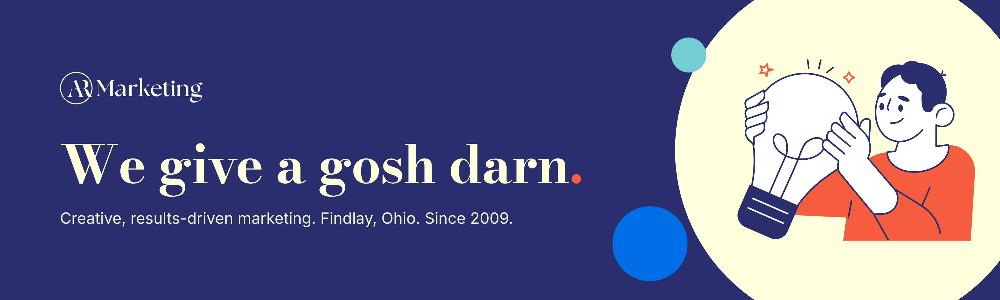

  

# Hi, we're AR Marketing.

We're a full-service marketing and creative agency in Findlay, Ohio. Since 2009, we've been the partner businesses trust to push creative boundaries and still drive results.

Yes, a marketing agency on GitHub. It makes sense, promise. [Skip to why.](#why-a-marketing-agency-is-on-github)

## What we do

Strategy and creative, under one roof. We think they should have lunch together more often.

| | |
|---|---|
| **Brand** | Identity and branding, from a first logo to a full brand system |
| **Events** | Branding for trade shows, annual meetings and publications |
| **Web** | Websites, designed and built |
| **Social, email and text** | Planned, written, designed and managed |
| **Paid media** | Google Ads and streaming TV (OTT/CTV) ads |
| **Direct mail** | Still works. We'll show you. |
| **Reputation and listings** | So people find you, and like what they find |
| **Photo and video** | Real moments, not stock |

  

## Who we work with

- **Independent businesses.** Grocery, retail, restaurants, maritime, entertainment and manufacturing. We help owners drive sales, repeat visits and loyalty.
- **National trade associations.** Design for membership, trade shows, publications and events.
- **Marinas.** Social, digital marketing and branding that drive bookings.
- **Healthcare.** Branding and strategy for local and regional providers.

## Why a marketing agency is on GitHub

Because this is where our client work lives. Every client has a private space here that holds their approved facts, their voice, the decisions we've made together and a record of every change.

A lot of the typing is done by AI. All of the deciding is done by people. Here's how we keep it that way:

- **Nothing goes out unchecked.** Every change is a proposal first. A person reviews it before it counts.
- **Facts come from one place.** If a stat, date or name isn't in a client's approved facts, it doesn't go in the work. No guessing.
- **The rules are written down.** Each client's brand rules and policies sit in one file that every session follows, human or AI.
- **Some checks don't take anyone's word for it.** Automatic checks run on every change, looking for passwords, misplaced files and broken links.
- **Client files stay private.** That's why you won't find public code here. It's not you, it's our clients.
- **We're honest about AI.** It's a tool, like Photoshop. A person owns everything that leaves AR under our name. If you ask how something was made, we'll tell you.

## What we believe

> We believe first impressions last forever.
>
> We believe in real strategy, not just pretty graphics.
>
> We believe that trends come and go, but great marketing stands the test of time.
>
> We believe that there are no bad ideas, usually.
>
> We believe afternoon coffee is acceptable.

And three things we've run on since day one: **fun**, **creative collaboration** and **thinking like owners**.

## Your marketing deserves better. Let's talk.

[a-rmarketing.com](https://a-rmarketing.com) · 419.427.2772

203 E. Crawford Street, Findlay, OH 45840
